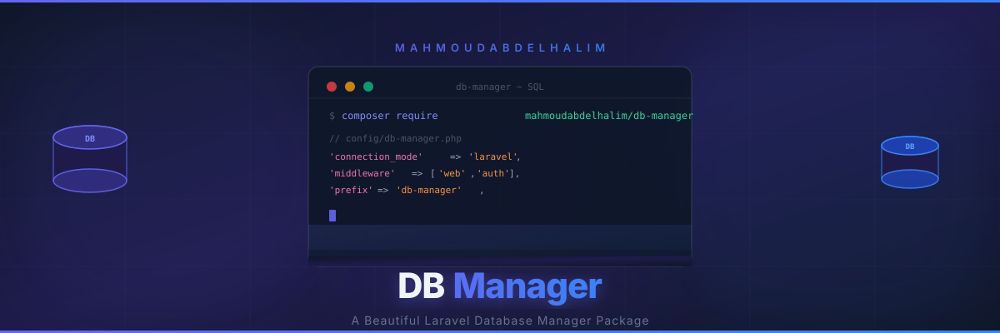

<p align="center">
  
</p>

<p align="center">
  <a href="https://packagist.org/packages/mahmoudabdelhalim/db-manager">
    
  </a>
  <a href="https://packagist.org/packages/mahmoudabdelhalim/db-manager">
    
  </a>
  <a href="https://packagist.org/packages/mahmoudabdelhalim/db-manager">
    
  </a>
  <a href="https://packagist.org/packages/mahmoudabdelhalim/db-manager">
    
  </a>
  <a href="LICENSE.md">
    
  </a>
</p>

<br/>

**DB Manager** is a beautiful, full-featured Laravel package that brings a phpMyAdmin-style database management UI directly into your Laravel application — no separate installation, no separate authentication. Browse tables, run SQL queries, manage structure, insert and edit rows, import/export databases — all from a clean, modern interface protected by your own middleware stack.

---

## ✨ Features

- 🗄️ **Browse & manage** databases, tables, columns, indexes, and foreign keys
- ✏️ **Insert, edit, and delete** rows with smart type-aware inputs
- ⚡ **SQL editor** with syntax highlighting (CodeMirror) and auto-pagination
- 📤 **Export** databases as SQL dumps
- 📥 **Import** SQL files directly from the browser
- 🔌 **Three connection modes** — use Laravel's own DB, show all databases, or present a custom login form
- 🛡️ **Fully protected** by your existing Laravel middleware (`auth`, gates, custom middleware)
- 🎨 **Self-contained UI** — no CSS framework conflicts, no dependency on your app's layout
- ⚙️ **Publishable** config and service provider stub for deep customization
- 🔧 **Zero config** out of the box — works immediately after install

---

## 📋 Requirements

| Requirement | Version |
|-------------|---------|
| PHP | `^8.2` |
| Laravel | `^10.0 \| ^11.0 \| ^12.0` |
| MySQL / MariaDB | any version supported by PDO |

---

## 🚀 Installation

Install the package via Composer:

```bash
composer require mahmoudabdelhalim/db-manager
```

The package is auto-discovered by Laravel — no manual provider registration needed.

That's it. Visit `/db-manager` in your browser (you must be logged in via Laravel's default `auth` middleware).

---

## ⚙️ Configuration

Publish the config file:

```bash
php artisan vendor:publish --tag=db-manager-config
```

This creates `config/db-manager.php`:

```php
return [

    /*
    |--------------------------------------------------------------------------
    | Enable / Disable
    |--------------------------------------------------------------------------
    | Quickly turn the entire UI on or off without touching routes.
    | When disabled, all DB Manager routes return a 404.
    */
    'enabled' => env('DB_MANAGER_ENABLED', true),

    /*
    |--------------------------------------------------------------------------
    | URL Prefix
    |--------------------------------------------------------------------------
    | The URI prefix for all DB Manager routes.
    | Default: yourapp.com/db-manager
    */
    'prefix' => env('DB_MANAGER_PREFIX', 'db-manager'),

    /*
    |--------------------------------------------------------------------------
    | Middleware
    |--------------------------------------------------------------------------
    | Middleware applied to all DB Manager routes.
    | Add any gate, role, or custom middleware here.
    */
    'middleware' => ['web', 'auth'],

    /*
    |--------------------------------------------------------------------------
    | Connection Mode
    |--------------------------------------------------------------------------
    | Controls how DB Manager connects to MySQL.
    |
    | 'laravel'  — auto-connects using Laravel's default DB config,
    |              shows only the application's own database.
    |
    | 'all'      — same credentials as 'laravel' but shows every
    |              database on the MySQL server.
    |
    | 'custom'   — presents a login form; credentials are stored
    |              in the session for the duration of the visit.
    */
    'connection_mode' => env('DB_MANAGER_CONNECTION_MODE', 'laravel'),

    /*
    |--------------------------------------------------------------------------
    | Laravel Connection Name
    |--------------------------------------------------------------------------
    | Which connection from config/database.php to use in 'laravel'
    | and 'all' modes. Leave null to use the default connection.
    */
    'connection' => env('DB_MANAGER_CONNECTION', null),

];
```

You can also set these values in your `.env` file:

```env
DB_MANAGER_ENABLED=true
DB_MANAGER_PREFIX=db-manager
DB_MANAGER_CONNECTION_MODE=laravel
DB_MANAGER_CONNECTION=mysql
```

---

## 🔌 Connection Modes

### `laravel` *(default)*

Automatically connects using your app's existing database credentials from `config/database.php`. Only your application's own database is shown. No login form — access is controlled entirely by your middleware.

```php
'connection_mode' => 'laravel',
'connection'      => null, // uses DB_CONNECTION from .env
```

### `all`

Same as `laravel` but shows **all databases** on the MySQL server that the configured user has access to. Useful for developers managing multiple databases on the same server.

```php
'connection_mode' => 'all',
```

### `custom`

Presents a MySQL login form on first visit. Credentials (host, port, username, password) are stored in the session. The user can disconnect at any time. Ideal for shared developer tools or staging environments.

```php
'connection_mode' => 'custom',
```

---

## 🛡️ Middleware & Authorization

By default, DB Manager is protected by `['web', 'auth']` — meaning the user must be authenticated in your Laravel app. You can change this to any middleware, gate, or role in the config:

```php
// config/db-manager.php

'middleware' => ['web', 'auth', 'can:access-db-manager'],
```

Or use a role-based package like Spatie:

```php
'middleware' => ['web', 'auth', 'role:admin'],
```

### Custom Service Provider (Advanced)

For full control, publish the service provider stub:

```bash
php artisan vendor:publish --tag=db-manager-provider
```

This creates `app/Providers/DbManagerServiceProvider.php`. Register it in `bootstrap/providers.php` (Laravel 11+):

```php
// bootstrap/providers.php
return [
    App\Providers\DbManagerServiceProvider::class,
];
```

Or in `config/app.php` (Laravel 10):

```php
'providers' => [
    App\Providers\DbManagerServiceProvider::class,
],
```

> **Note:** Once you register your custom provider, remove the package's auto-discovery entry from `config/app.php`'s `dont-discover` array or the package's own provider will also register — causing duplicates.

---

## 📁 Published Files Reference

| Command | Publishes to |
|---------|-------------|
| `--tag=db-manager-config` | `config/db-manager.php` |
| `--tag=db-manager-provider` | `app/Providers/DbManagerServiceProvider.php` |

---

## 🔒 Security

If you discover any security vulnerabilities, please send an email to **mahmoud@grandercodes.com** instead of opening a public issue.

---

## 📄 License

This package is open-source software licensed under the **MIT License**. See the [LICENSE](LICENSE.md) file for details.

---

<p align="center">
  Made with ❤️ by <a href="https://github.com/mahmoudabdelhalim">Mahmoud Abd Elhalim</a>
</p>
